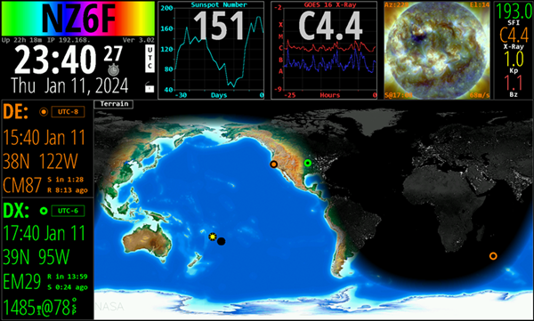

# HamClock Docker

A Docker distribution of [OpenHamClock](https://github.com/openhamclock/hamclock), based on HamClock by Elwood Downey, WB0OEW (SK). Thanks to Julius Zeidler ([@zeidlos](https://github.com/zeidlos)) for his earlier [Dockerized HamClock](https://github.com/zeidlos/hamclock-docker).



The existing GHCR stable images are still the older HamClock build using `hamclock.com`; they are not automatically replaced by the OpenHamClock candidates. OpenHamClock publishes its own [Docker image and manager](https://github.com/openhamclock/hamclock/tree/main/docker), which may be preferable for new installations. This project retains the existing GHCR image name, resolution tags, settings volume and command conventions.

## Run a published image

Install Docker and Docker Compose, then save [examples/docker-compose.yaml](examples/docker-compose.yaml) as `docker-compose.yaml` and run:

```sh
docker compose up -d
```

Open `http://YOUR_DOCKER_HOST:8081/live.html`. The API is on port 8080; port 8082 can optionally expose the read-only UI. Change the host side of the port mappings if needed. Settings persist in the `data` volume mounted at `/root/.hamclock`.

The current stable resolution tags are:

| Resolution | Tags |
|---|---|
| 1600x960 | `latest`, `1600x960`, version or version-`1600x960` |
| 2400x1440 | `2400x1440`, version-`2400x1440` |
| 3200x1920 | `3200x1920`, version-`3200x1920` |

These are separate, fixed-resolution images, not runtime-resizable displays. The existing stable images support `linux/amd64`, `linux/arm64` and `linux/arm/v7`. A release or tag in GitHub does not necessarily mean a corresponding image was published.

## Test an OpenHamClock candidate

Candidate builds are opt-in and do **not** move `latest`, the resolution aliases, or existing version tags. The manually dispatched Docker Build workflow publishes unique tags of the form:

```text
ghcr.io/chrisromp/hamclock-docker:candidate-v4.33.0-1600x960-RUN_ID-ATTEMPT
```

Use the exact tag and digest from the workflow run summary; substitute the desired resolution. Check the workflow's smoke-test artifacts for startup logs, API output and, on amd64, a Playwright screenshot. A published candidate may still have failing smoke tests; review the run before using it. Multi-architecture coverage is validated during publication, and a failed target is not silently removed.

Back up the settings volume before trying a candidate, and use a **copy** of it for testing. Find the actual volume name with `docker volume ls` or `docker inspect` on the existing container. For example, with the original stopped:

```sh
docker run --rm -v YOUR_VOLUME:/source:ro -v "$(pwd):/backup" alpine \
  tar czf /backup/hamclock-settings-backup.tar.gz -C /source .
docker volume create hamclock-candidate-data
docker run --rm -v hamclock-candidate-data:/destination -v "$(pwd):/backup:ro" alpine \
  tar xzf /backup/hamclock-settings-backup.tar.gz -C /destination
```

Use the candidate tag and copy in a separate Compose project and different host ports, or stop the existing container first. Do not mount the same writable settings volume in both instances. Keep the original backup for rollback.

The candidate defaults to the public [Open HamClock Backend](https://github.com/openhamclock/open-hamclock-backend) at `ohb.hamclock.app:80`. Configure a different host and port with:

```yaml
environment:
  BACKEND_HOST: your-server.example:80
```

The legacy full `command: ["/usr/local/bin/hamclock", "-o", "-b", "your-server.example:80"]` override also works and takes precedence over that environment variable. The backend is separate from the frontend; self-hosting it is optional. Public backend reachability depends on your network and the service.

## Build from source

With `gh`, Python 3 and Docker installed, download and verify the latest stable OHC source asset, then build:

```sh
python3 scripts/ohc_release.py --output ESPHamClock.zip
docker compose up --build -d
```

Use `--tag v4.33.0` to pin an exact release, or `--channel beta` to select the newest beta. The script verifies the GitHub release asset's SHA-256; it does not fall back to an unversioned download. Set `HAMCLOCK_RESOLUTION` in the source Compose file to one of `800x480`, `1600x960`, `2400x1440`, or `3200x1920` before building.

## Updating and rollback

Back up settings first. For image-based deployments, update the image tag in Compose if necessary, then run `docker compose pull && docker compose up -d`. Updating inside the HamClock web UI does not persist reliably across container recreation.

If a candidate does not work, stop it and restore the original deployment and saved settings. The legacy `v4.25` image and `v4.25-2400x1440` / `v4.25-3200x1920` tags correspond to the existing floating images observed during the migration assessment; use the matching resolution or a previously recorded digest. Do not assume `v4.27` was published as a container image. Stable promotion of OpenHamClock images is a separate decision.

## Moving to the upstream manager

The [OHC manager](https://github.com/openhamclock/hamclock/tree/main/docker) uses a different image, defaults to 2400x1440, and mounts `hc.settings` as `/opt/hamclock/.hamclock/eeprom` under UID/GID 1199. To migrate, stop the old container, back up its full settings volume, copy its `eeprom` file to `hc.settings`, and make that copy writable by UID/GID 1199. Select your original size with the manager's `-s` option and avoid host-port conflicts. Keep the original volume and backup until migration is verified.

## Support

This project is provided without guarantees. Please [open an issue](https://github.com/ChrisRomp/hamclock-docker/issues) with your platform and relevant errors if you encounter a problem.
